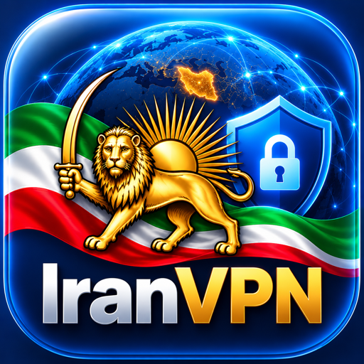
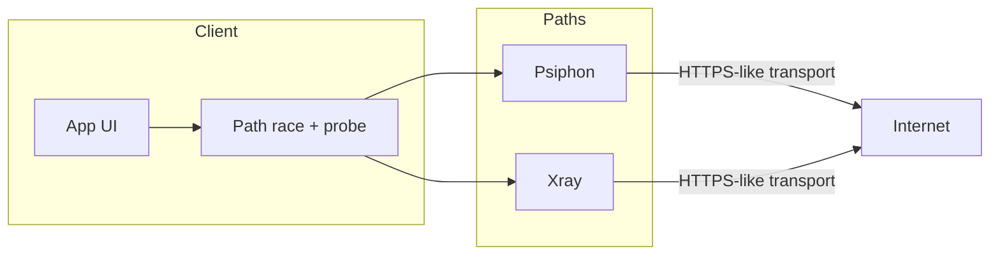
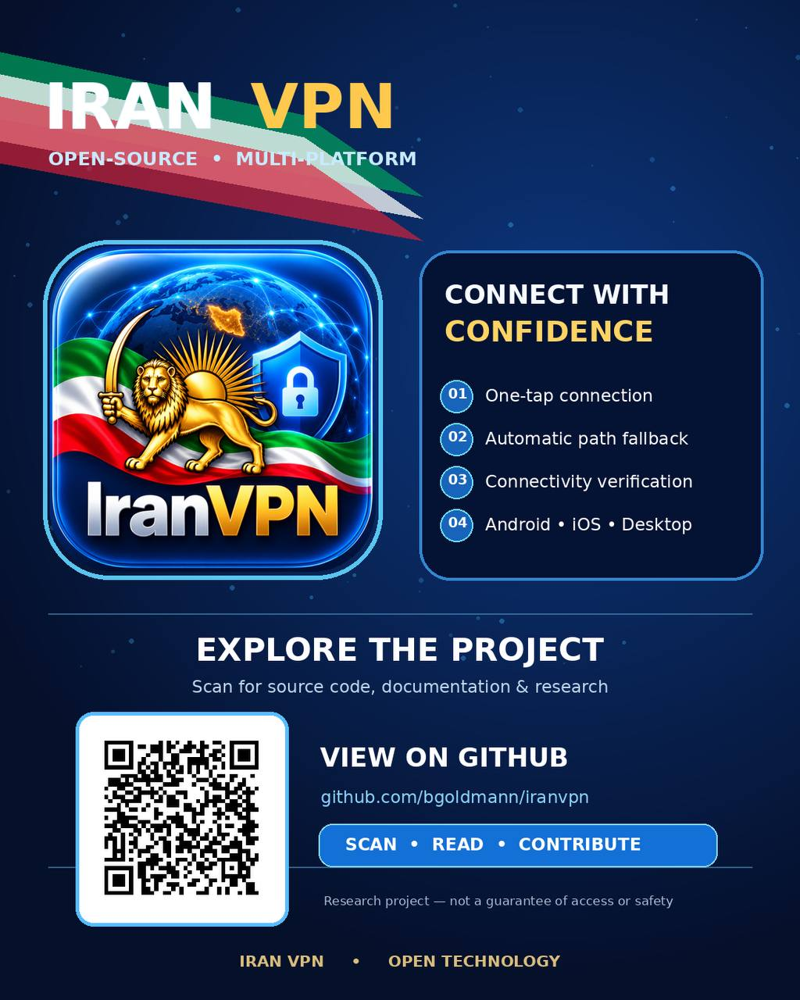

<p align="center">
  
</p>

<h1 align="center">Iran VPN</h1>

<p align="center">
  <strong>Open-source client for safer access to information on filtered networks</strong>
</p>

<p align="center">
  One-tap connect · Automatic path fallback · Android · iOS · Windows · macOS
</p>

<p align="center">
  <a href="https://goldmannllc.com/websites/iranvpn"></a>
  <a href="https://www.opensignalfoundation.org/projects/iranvpn"></a>
  <a href="report-iran-vpn-2026/README.md"></a>
  <a href="prd.md"></a>
  
</p>

<p align="center">
  <a href="#features">Features</a> ·
  <a href="#architecture">Architecture</a> ·
  <a href="#advertisement-poster">Poster</a> ·
  <a href="#quick-start">Quick start</a> ·
  <a href="#documentation">Docs</a> ·
  <a href="#legal-notice">Legal</a>
</p>

---

## Why this exists

Iran’s filtering stack combines DNS poisoning, deep packet inspection, protocol whitelisting (HTTP/HTTPS/DNS), and large-scale domain blocking. Conventional VPNs (plain OpenVPN, unprotected WireGuard) are routinely detected and blocked.

**Iran VPN** is a multi-platform research client that races censorship-resistant paths, probes connectivity before claiming Connected, and fails closed (kill switch) when a tunnel is not ready.

> Publisher: [Goldmann LLC](https://goldmannllc.com) · Project research: [Open Signal Foundation — IranVPN](https://www.opensignalfoundation.org/projects/iranvpn)

---

## Features

| | |
|---|---|
| **One-tap connect** | Zero-config default path — no server import required for first use |
| **Path race + fallback** | Psiphon (incl. Conduit) and Xray competed in parallel with a probe gate |
| **Kill switch** | Never reports Connected until SOCKS/tunnel probe succeeds |
| **Share-link import** | Optional advanced VLESS / VMess / Trojan / REALITY configs |
| **Multi-platform** | Android, iOS, Windows, macOS from one research codebase |
| **Decentralized config** | Redundant bootstrap sources + last-good cache |

---

## Architecture



### Repository layout

| Path | Role |
|------|------|
| [`core/`](core/) | Rust shared library — race engine, config types, DoH, FFI/JNI |
| [`android/`](android/) | Kotlin + Jetpack Compose · VpnService · tun2socks · Psiphon/Xray |
| [`ios/`](ios/) | SwiftUI · dual Packet Tunnel extensions (Psiphon + LibXray) |
| [`macos/`](macos/) | SwiftUI · Network Extension |
| [`windows/`](windows/) | Rust + egui · Wintun |
| [`station/`](station/) | Volunteer P2P / Conduit-style relay helpers |
| [`dist-config/`](dist-config/) | Bootstrap server-list distribution |
| [`report-iran-vpn-2026/`](report-iran-vpn-2026/) | Research report |
| [`docs/`](docs/) | Legal, protocol notes, [store publish guide](docs/store-publish-guide.md) |
| [`assets/branding/`](assets/branding/) | App icon & logo |
| [`assets/advertising/`](assets/advertising/) | Verified advertisement poster, Reel adaptation, and campaign copy |

---

## Advertisement poster

<p align="center">
  <a href="https://github.com/bgoldmann/iranvpn">
    
  </a>
</p>

The poster's QR code resolves directly to this repository. Platform-ready media and approved campaign copy are documented in [`assets/advertising/`](assets/advertising/).

---

## Quick start

### Prerequisites

- Rust toolchain (for `core/` and Windows)
- Android Studio / SDK 35+ *(Android)*
- Xcode 16+ & Apple Developer team *(iOS / macOS)*
- Network access to fetch tunnel binaries where required

### Core

```bash
cd core && cargo build
```

### Android

```bash
./scripts/fetch-tun2socks-prebuilt.sh
# optional: ./scripts/build-android-core.sh
cd android && ./gradlew assembleDebug
```

Details: [`android/README.md`](android/README.md)

### iOS

```bash
./scripts/fetch-ios-tunnel-deps.sh   # PsiphonTunnel + LibXray (~540MB, gitignored)
open ios/IranVPN.xcworkspace
```

Details: [`ios/README.md`](ios/README.md) · Store listing copy: [`docs/store-publish-guide.md`](docs/store-publish-guide.md)

### Windows / macOS

- Windows: [`windows/README.md`](windows/README.md)
- macOS: [`macos/README.md`](macos/README.md)

---

## Documentation

| Document | Description |
|----------|-------------|
| [Research report 2026](report-iran-vpn-2026/README.md) | Filtering system, techniques, open-source landscape, recommendations |
| [Product requirements](prd.md) | User stories, FR/NFR |
| [Changelog](CHANGELOG.md) | Release history |
| [Legal disclaimer](docs/legal-disclaimer.md) | Legal + operational security |
| [Protocol integration](docs/protocol-integration.md) | Adding / wiring path runners |
| [Store publish guide](docs/store-publish-guide.md) | App Store & Play titles, keywords, URLs |
| [Distribution](docs/distribution.md) | Config publishing |

### Research report chapters

1. [Executive Summary](report-iran-vpn-2026/01-executive-summary.md)
2. [Iran's Filtering System](report-iran-vpn-2026/02-iran-filtering-system.md)
3. [VPN Circumvention Techniques](report-iran-vpn-2026/03-vpn-circumvention-techniques.md)
4. [Open Source Solutions](report-iran-vpn-2026/04-open-source-solutions.md)
5. [Recommendations](report-iran-vpn-2026/05-recommendations.md)
6. [References](report-iran-vpn-2026/06-references.md)

---

## Links

| | |
|---|---|
| Product page | [goldmannllc.com/websites/iranvpn](https://goldmannllc.com/websites/iranvpn) |
| Privacy | [goldmannllc.com/privacy](https://goldmannllc.com/privacy) |
| Support | [goldmannllc.com/contact](https://goldmannllc.com/contact) · `support@goldmannllc.com` |
| Research | [opensignalfoundation.org/projects/iranvpn](https://www.opensignalfoundation.org/projects/iranvpn) |
| Safety | [opensignalfoundation.org/safety](https://www.opensignalfoundation.org/safety) |

---

## Legal notice

**Unauthorized VPN use is illegal in Iran** (Supreme Council of Cyberspace, February 2024).

This project is for **research and informational use only**. We do not encourage illegal activity. Users assume all legal and personal risks. No tool guarantees safety, anonymity, or access.

See [`docs/legal-disclaimer.md`](docs/legal-disclaimer.md) and [Open Signal Foundation — Safety & Legal](https://www.opensignalfoundation.org/safety).

---

## License

See the repository license file when published. Third-party components (Psiphon, Xray/LibXray, Conduit, tun2socks, and others) remain under their respective licenses.

---

<p align="center">
  <sub>Built by <a href="https://goldmannllc.com">Goldmann LLC</a> · Research with <a href="https://www.opensignalfoundation.org">Open Signal Foundation</a></sub>
</p>
