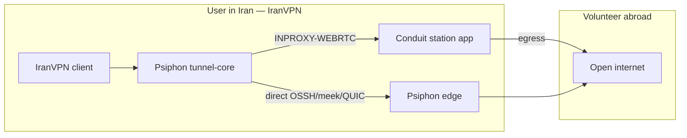

# Conduit integration — research and plan

Deep dive on how **Psiphon Conduit** relates to IranVPN, what “adding Conduit” actually means, and a concrete roadmap. Sources: [Psiphon-Inc/conduit](https://github.com/Psiphon-Inc/conduit), [psiphon-tunnel-core `config.go`](https://github.com/Psiphon-Labs/psiphon-tunnel-core/blob/master/psiphon/config.go), [AzadiTunnel bundled config](https://github.com/polamgh/AzadiTunnel/blob/main/docs/BUNDLED_PSIPHON_CONFIG.md), and this repo’s current clients.

## Executive verdict

| Idea | Reality |
|------|---------|
| Separate “Conduit path” racing beside Psiphon | **Wrong model.** Conduit is Psiphon’s **in-proxy** mode inside `psiphon-tunnel-core`, not a second VPN stack. |
| Users in Iran “use Conduit” | They run a **Psiphon client** that can dial **`INPROXY-WEBRTC-*`** tunnels via volunteer **stations**. |
| Volunteers “run Conduit” | They run the official **Conduit station app/CLI** (`InproxyEnableProxy`), not IranVPN. |
| Our `ConduitPathRunner` | Stub that always fails — by design today. Do **not** race it as a peer of Psiphon. |
| iOS volunteer station | Official Conduit **iOS station is not released** (Expo module stubs `ERR_UNIMPLEMENTED`). |

**Correct product goal:** make IranVPN’s Psiphon path **actually eligible for in-proxy/Conduit**, surface when it is used, and optionally support **personal pairing** + **deep-link to Conduit station** for diaspora — without inventing a parallel protocol.

---

## How Conduit works (two roles)

### 1) Client (censored region) — what IranVPN is

Tunnel-core can establish tunnels via:

- **Direct** protocols (`OSSH`, meek, QUIC, …) to Psiphon servers.
- **In-proxy** protocols (`INPROXY-WEBRTC-<base>`), default-disabled until **tactics / parameters** (and/or config) allow them.

Key client config fields (`psiphon/config.go`):

| Field | Role |
|-------|------|
| `InproxyClientPersonalCompartmentID` | Personal pairing: client **only** uses in-proxy, and only stations with the matching proxy compartment ID. |
| `InproxyCommonCompartmentIDs` | Shared/common compartments (usually from tactics, not hardcoded). |
| `InproxyAllowClient` / broker specs | Mostly **testing overrides**; production brokers/STUN/tactics come from Psiphon. |
| Propagation / Sponsor / RemoteServerList / **`ServerEntrySignaturePublicKey`** | Required for a real network; AzadiTunnel: **in-proxy fails without entry signature key** (`entry_sig_key=false`). |

When personal compartment ID is set, tunnel-core enters personal pairing mode (`IsInproxyClientPersonalPairingMode`) and forces in-proxy-only dials.

Notices to watch (UI / diagnostics):

- Connected server region / protocol containing `INPROXY`
- `InproxyMustUpgrade` → client/station too old
- Proxy activity notices (station side)

### 2) Station / proxy (volunteer) — not IranVPN’s Connect button

Official Conduit ([Play: `ca.psiphon.conduit`](https://play.google.com/store/apps/details?id=ca.psiphon.conduit), [GitHub](https://github.com/Psiphon-Inc/conduit)):

- Android: Expo module runs **station mode** foreground service (`toggleInProxy`, bandwidth caps, reduced hours).
- CLI / Mac Catalyst releases on GitHub; **iOS app not released** (technical limitations; native module stubs unimplemented).
- Hosted “personal pairing” syncs `personal_compartment_id` via Conduit’s hosted API (account + entitlement).
- Needs Psiphon config from **conduit-oss@psiphon.ca** for OSS builds.

Station config maps to tunnel-core proxy fields: `InproxyEnableProxy`, `InproxyMaxClients`, rate limits, `InproxyProxyPersonalCompartmentID`, session private key, etc.

**IranVPN should not reimplement the station UI.** Point volunteers at Conduit (see `station/`).

---

## What IranVPN has today

| Layer | Status |
|-------|--------|
| Docs / PRD | Talk about “Psiphon → Conduit → Xray” as separate fallbacks |
| `core` / Android `PathKind.Conduit` | Config type exists; **skipped** in race (`DEFAULT_PATH_ORDER` = Psiphon → Xray → SingBox → Tor → Outline) |
| `ConduitPathRunner` | Always returns Failure (“included in Psiphon”) |
| Android `PsiphonPathRunner` | Real Psiphon SDK; IDs + embedded entries; **no** signature key / remote list / compartment |
| iOS / macOS Packet Tunnel | Same: Psiphon only; no in-proxy-specific keys |
| Windows | External `psiphon-tunnel-core` + TargetServerEntry; Conduit path errors out |
| `station/` | Launcher + docs → official Conduit |

So marketing says Conduit; **runtime Conduit/in-proxy almost certainly never engages** until distributor secrets + tactics are present.

---

## Prerequisites (blocking)

1. **Distributor relationship with Psiphon Inc.**  
   Proper `PropagationChannelId`, `SponsorId`, `RemoteServerListURLs`, `RemoteServerListSignaturePublicKey`, `ServerEntrySignaturePublicKey`, and tactics that enable in-proxy.  
   Research extracts (Shiro APK) help bootstrap **direct** dials; AzadiTunnel still requires signature keys for Conduit-grade in-proxy.

2. **Do not invent** broker specs, compartment IDs, or signature keys. Wrong keys → silent failure or unsafe clients.

3. **Same process constraints** as today: one Go runtime per process (Psiphon vs LibXray split already). Station mode in-process would compete with client mode — keep station **out of process** (separate Conduit app).

4. **Platform limits**  
   - iOS user client: in-proxy **client** can work inside Packet Tunnel if tunnel-core build supports it (same PsiphonTunnel xcframework).  
   - iOS station: **not available** from Psiphon; do not promise it.  
   - Android station: prefer Intent to Play Conduit; embedding station = large product + license surface.

---

## Recommended architecture for IranVPN

### A — Client: “Conduit as Psiphon capability” (primary)

1. Keep a **single** Psiphon path in the race.  
2. Enrich `shared/psiphon/psiphon-config.json` (and `.local.json`) with distributor keys when available.  
3. Optional Advanced: paste/QR **`InproxyClientPersonalCompartmentID`** for family/friend stations.  
4. Parse Psiphon diagnostic notices → set `activePath` to e.g. `Psiphon` vs `Psiphon / Conduit` when protocol is `INPROXY-*`.  
5. Delete or demote `ConduitPathRunner` from the race forever; keep config type only for “personal compartment” metadata if useful.

### B — Volunteer: deep-link / launcher (secondary)

| Platform | Approach |
|----------|----------|
| Android | Button “Share bandwidth (Conduit)” → Play Store / `ca.psiphon.conduit` Intent; optional `station/` docs in-app |
| Windows / macOS | Keep `station/launch-conduit.sh`; ship link to Conduit CLI releases |
| iOS | Copy explaining stations need Android/desktop Conduit; no in-app station |

### C — Personal pairing UX (optional, high value for diaspora)

1. Station operator runs Conduit → shares personal compartment ID (hosted or out-of-band).  
2. IranVPN Advanced → “Personal Conduit code” → writes `InproxyClientPersonalCompartmentID` into provider config / App Group / assets override.  
3. Connect forces in-proxy-only to that station (tunnel-core behavior).  
4. Clear pairing → back to normal Psiphon (direct + network in-proxy if tactics allow).

### D — What not to build

- A second PathRunner that starts another PsiphonTunnel “for Conduit.”  
- Embedding Conduit’s React Native app inside IranVPN.  
- Claiming “Connected via Conduit” without INPROXY notices / protocol.  
- iOS Packet Tunnel that also runs `InproxyEnableProxy` (station) — wrong role + Apple background limits.

---

## Implementation phases

### Phase 0 — Honesty (docs/UI) — 0.5 day

- UI string: “Conduit/P2P is part of Psiphon when available; not a separate switch.”  
- Update Android README / PRD language to match.  
- Keep `station/README.md` as volunteer path.

### Phase 1 — Make in-proxy *possible* — blocked on keys

- Obtain Psiphon distributor package (or complete Shiro + `merge-shiro-distributor-keys` style local.json).  
- Ensure `ServerEntrySignaturePublicKey` + remote list in `psiphon-config.local.json` (gitignored).  
- Confirm with `EmitDiagnosticNotices`: tactics mention in-proxy / `INPROXY` candidates.  
- Sync via `./scripts/sync-psiphon-bootstrap.sh` + document local overlay.

### Phase 2 — Detect & display Conduit use — 1–2 days

- iOS/macOS: `onDiagnosticMessage` / notice hooks → detect `INPROXY` / in-proxy connected.  
- Android: HostLogger / notice callback if exposed by `ca.psiphon:psiphontunnel`.  
- Set `activePathName` accordingly; optional Settings row “Last path: Conduit (in-proxy).”

### Phase 3 — Personal pairing — 2–3 days

- Advanced field + persistence (Keychain / EncryptedSharedPreferences / App Group).  
- Inject `InproxyClientPersonalCompartmentID` into tunnel config only when set.  
- Warn: pairing mode = **in-proxy only** (no direct fallback until cleared).

### Phase 4 — Volunteer CTA — 1 day

- Android: open Conduit app or Play.  
- Desktop: open conduit.psiphon.ca / GitHub Releases.  
- Do not duplicate Cure53 / bandwidth UI; link out.

### Phase 5 — (Optional) Android station embed — large, discouraged

Only if product requires one APK for volunteers: vendoring tunnel-core proxy mode with `InproxyEnableProxy`, FGS `specialUse`, separate process from VPN client. Prefer official Conduit instead.

---

## Platform matrix

| Capability | Android | iOS | macOS | Windows |
|------------|---------|-----|-------|---------|
| In-proxy **client** via Psiphon | Yes (SDK) | Yes (PsiphonTunnel in appex) | Yes | Yes (CLI tunnel-core) |
| Show Conduit when used | Needs notice plumbing | Needs notice plumbing | Same | Parse stdout/notices |
| Personal compartment input | Easy | Easy (App Group → appex) | Easy | Config file |
| **Station** in IranVPN | Deep-link preferred | **No** (Psiphon gap) | Launch CLI | Launch CLI |
| Separate Conduit PathRunner | No | No | No | No |

---

## Testing plan

1. Direct-only build (current): Connect succeeds; no INPROXY in logs.  
2. With distributor keys: notices show in-proxy candidates; occasional INPROXY connect under load/tactics.  
3. With personal compartment + matching Conduit station abroad: Connect only via that station; kill station → fail closed.  
4. Clear pairing → direct works again.  
5. Never claim Connected without SOCKS probe (existing gate).

---

## Open questions for Psiphon / product

1. Can Open Signal Foundation get a **distributor** channel with in-proxy tactics enabled for Iran?  
2. Is shipping Shiro-extracted signature keys legally/ToS-acceptable, or must keys come from Psiphon?  
3. Do we want **personal pairing** in v1, or only opportunistic network in-proxy?  
4. Volunteer CTA in-app vs docs-only?

---

## References

- [Conduit README](https://github.com/Psiphon-Inc/conduit) — station app; config from conduit-oss@psiphon.ca; iOS not released  
- [conduit expo-psiphon-tunnel-core](https://github.com/Psiphon-Inc/conduit/tree/main/modules/expo-psiphon-tunnel-core) — Android station; iOS stub  
- [tunnel-core config Inproxy*](https://github.com/Psiphon-Labs/psiphon-tunnel-core/blob/master/psiphon/config.go)  
- [AzadiTunnel BUNDLED_PSIPHON_CONFIG](https://github.com/polamgh/AzadiTunnel/blob/main/docs/BUNDLED_PSIPHON_CONFIG.md) — signature key required for Conduit  
- Repo: `station/README.md`, `docs/psiphon-integration.md`, `android/.../ConduitPathRunner.kt`
